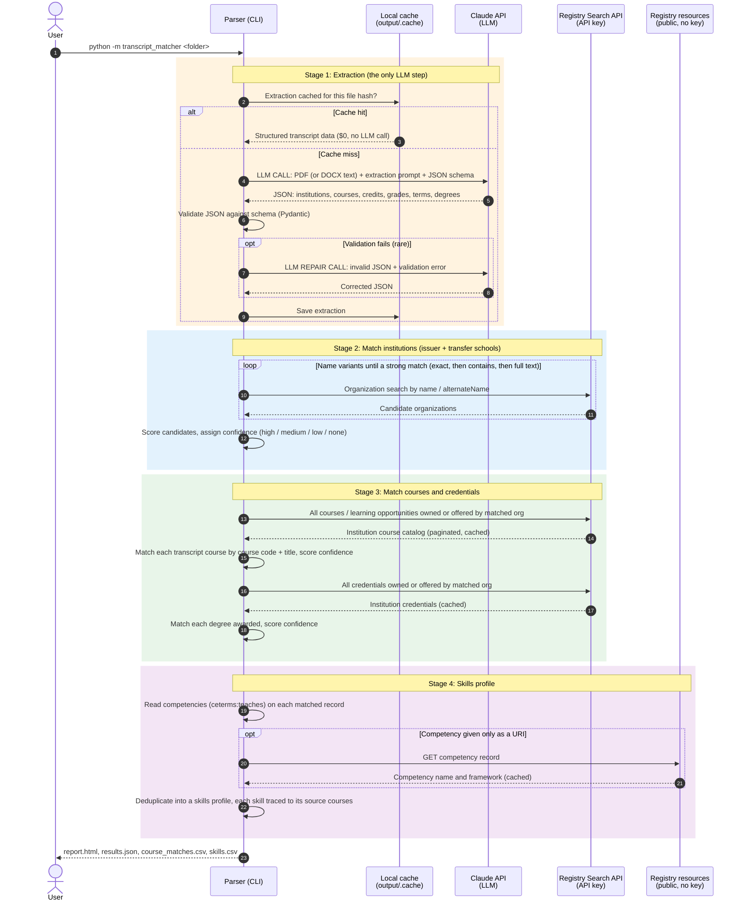

# How the Transcript Parser Works

The parser turns a transcript document into Registry-linked data: matched
institutions, courses, and credentials (with CTIDs and confidence ratings) and
a skills profile built from the competencies those courses teach.

**The LLM does exactly one job: reading the transcript.** Claude is called once
per transcript to turn the document into structured data (plus, rarely, one
repair call if its JSON fails validation). Everything after that, including
Registry search, matching, confidence scoring, and skills retrieval, is
deterministic code calling the Credential Registry. Same inputs, same outputs.

## Sequence diagram (one transcript)

## What each participant is

| Participant | Role | Cost |
|---|---|---|
| **Claude API** | Reads the transcript (PDF, including scanned pages, or DOCX) into structured data. The only AI step. | About $0.12 for a typical 4 page transcript; $0 when cached |
| **Registry Search API** | Finds organizations, course catalogs, and credentials. Requires a Credential Engine API key. | No Anthropic cost |
| **Registry resources** | Public CTDL records, fetched only to resolve competency names referenced by URI. | Free, no key |
| **Local cache** | Stores extractions (by file hash) and Registry responses so re-runs skip repeated work. | n/a |

## Key design points

- **One LLM call per transcript, then deterministic.** Matching decisions are
  inspectable code, not model judgments, which makes results reproducible and
  explainable to registrars. See [confidence.md](confidence.md) for how scores
  are computed.
- **Catalog download, then local matching.** Courses are matched against the
  institution's full Registry catalog in memory rather than one API call per
  course, keeping Registry traffic to a handful of calls per transcript.
- **Skills are linked data, not inference.** Competencies come directly from
  the matched Registry records. The LLM never guesses skills.
- **Coverage is visible.** When a matched institution has no course records in
  the Registry, the report says so explicitly instead of reporting a failed
  match.

Code map: extraction in [`extract.py`](../transcript_matcher/extract.py),
Registry queries in [`registry.py`](../transcript_matcher/registry.py),
matching, scoring, and skills in [`match.py`](../transcript_matcher/match.py),
outputs in [`report.py`](../transcript_matcher/report.py).
